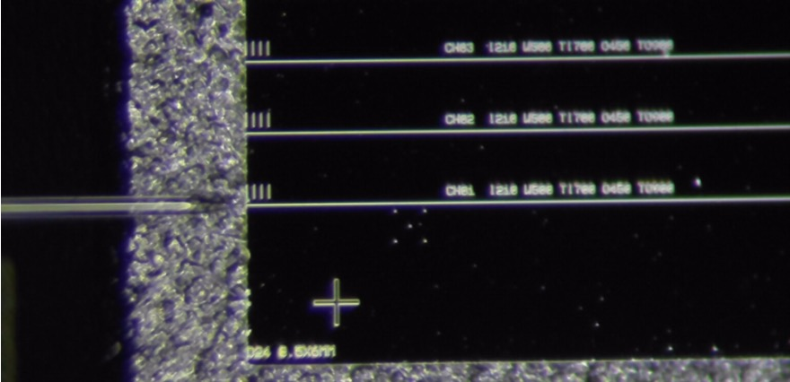
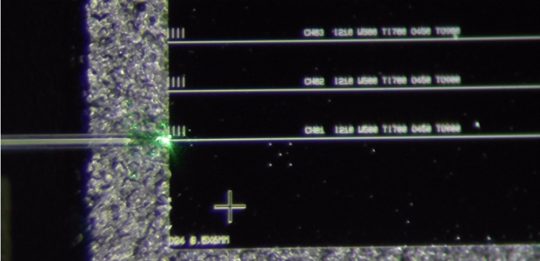
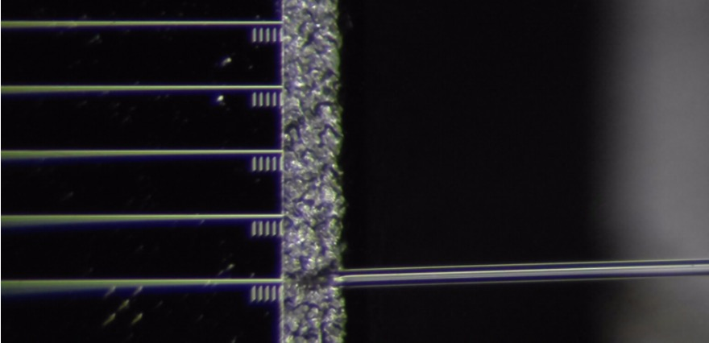
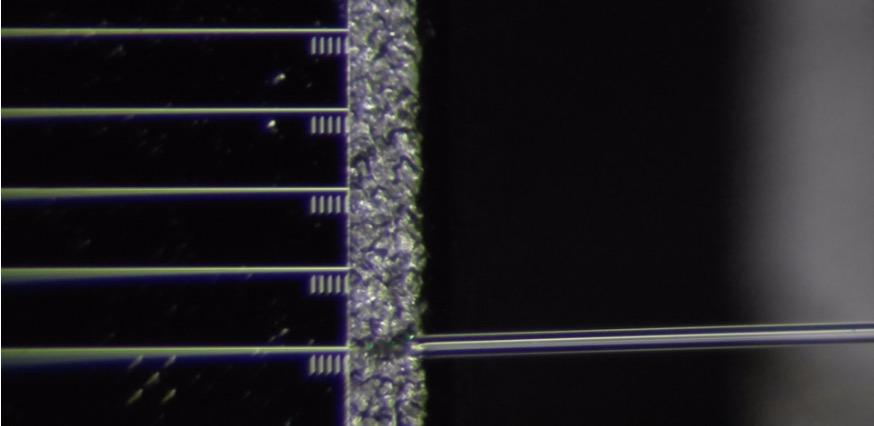
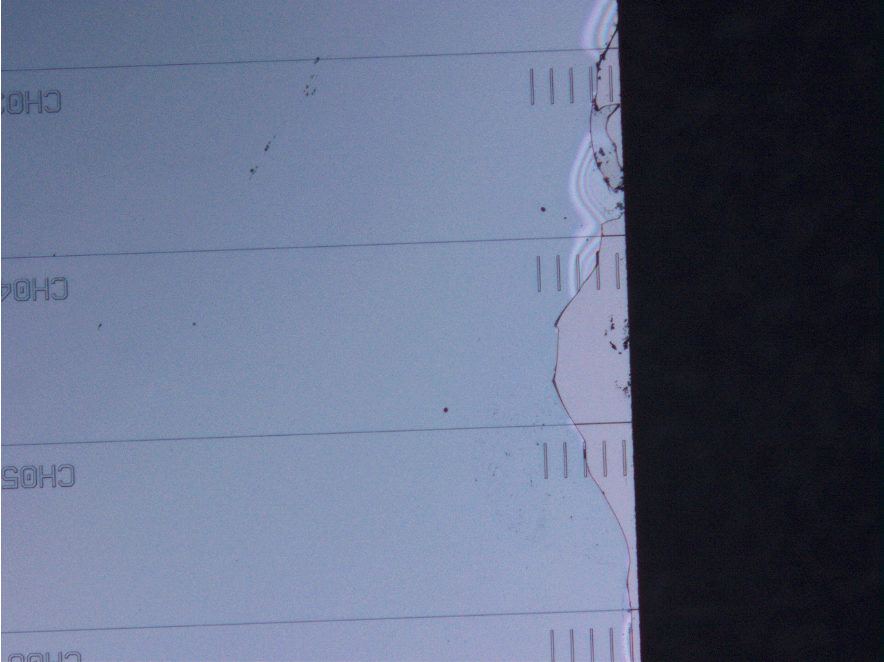
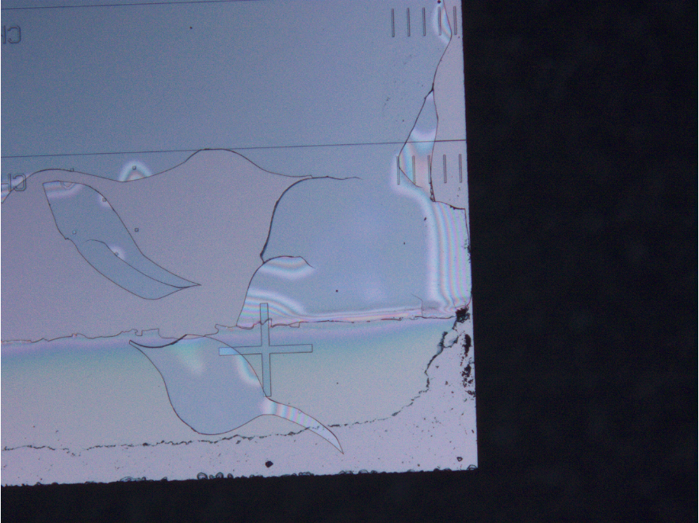
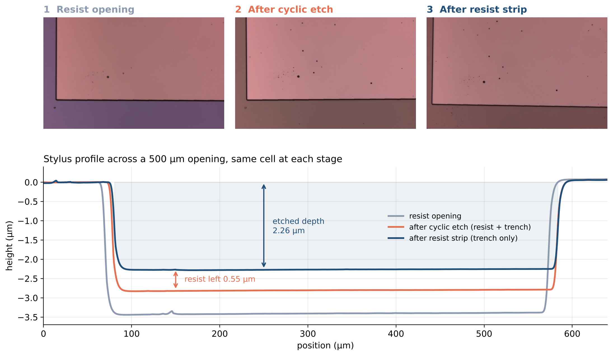
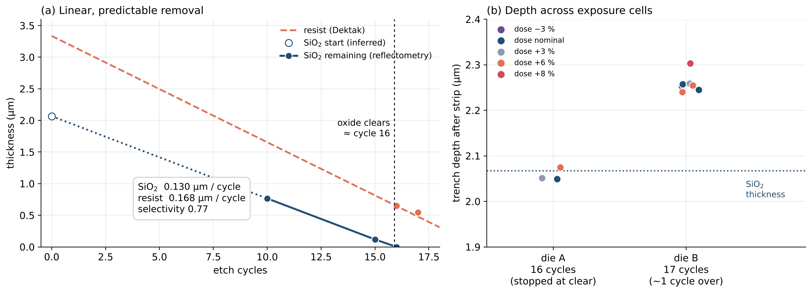
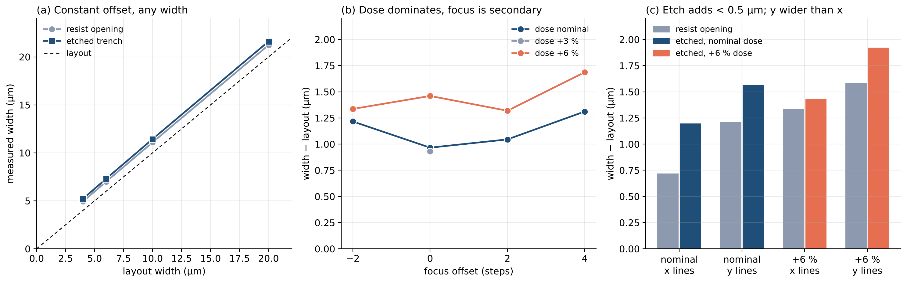

# SiN Photonic Components and Process Metrology

**Jun Young Hong · Optical interfaces, component modeling and fabrication checks**

The study connects visible-wavelength pump delivery and fluorescence collection with the geometry that fabrication can produce. It separates guided-mode transport, fiber/facet coupling and process metrology rather than treating one high simulated transmission as device validation.

**Experimental work:** [532 nm Fiber-to-Chip Edge Coupling and Facet Preparation](experiments/edge-coupling/README.md)

## 1. Physical Stack and Optical Confinement

Changing cladding changes confinement and interface behavior. Air-clad and oxide-clad cases are distinct physical models, not one same-stack parameter sweep.

## 2. Component Design and Optical Propagation

The inverse-taper and strip-to-slot studies compare guided-mode transport under their stated model boundaries. The wavelength response is a component calculation, not measured fluorescence collection. Fiber-mode mismatch, alignment, facet quality and reflection remain additional interface effects.

## 3. Fiber-to-Chip Edge Coupling and Facet Preparation

Preliminary 532 nm fiber-to-chip alignment trials were conducted using conical lensed single-mode fibers, with input/output facet microscopy under laser OFF/ON conditions.

Localized green light was observed near the input fiber-chip interface. However, end-to-end guided waveguide transmission and coupling efficiency have not yet been verified.

Facet preparation trials on photonic chips with approximately 4 µm PECVD SiO2 cladding revealed edge chipping during polishing and additional damage following ultrasonic cleaning. The precise failure mechanism has not yet been established.

### 532 nm Edge-Coupling Observations

| Input: Laser OFF | Input: Laser ON |
|---|---|
|  |  |

| Output: Laser OFF | Output: Laser ON |
|---|---|
|  |  |

**Observation:** Localized green light was visible near the input facet with the 532 nm laser ON. Guided transmission through the waveguide has not yet been confirmed.

### Facet Polishing and Cladding Damage

| Facet edge chipping | Damage after ultrasonic cleaning |
|---|---|
|  |  |

**Observation:** Edge chipping during polishing and additional damage following ultrasonic cleaning were observed in chips with approximately 4 µm PECVD SiO2 cladding. The precise fracture mechanism has not been established.

[View full experimental setup, analysis, and next steps](experiments/edge-coupling/README.md)

## 4. Fabricated Structures and SEM Inspection

SEM images show coupling regions, routing and the strip-to-slot transition region of an earlier fabricated demonstrator. The original analysis adjusted image contrast. These are geometry observations, not measured optical performance or evidence that every modeled design was fabricated.

## 5. Process Metrology and Fabrication Variation

The maps derive from measured SPM data. The unusable all-zero panel remains visible rather than being replaced by a simulated surface.

Within-session fixed-dose comparisons show scan variation and exploratory three-time-point fits. Scan SD and fitted trend are descriptive; they are not a qualified etch rate or manufacturing yield.

Baseline, edge selection and fitting window affect extracted thickness. The saved instrument reading and independent profile fit are different estimates. Historical fits are shown without claiming a new extraction or a common deposition calibration across batches.

## 6. Opening the Oxide Window: Etch Control and Pattern Fidelity

The sensing region needs a window through the ~2 µm PECVD SiO2 top cladding, while the couplers stay oxide-clad. Thick photoresist was patterned by maskless UV lithography and transferred with a cyclic fluorine plasma etch that includes an in-loop cooling step. Early loops without adequate cooling deformed the resist; adding the cooling step kept the mask intact through 17 cycles.

The same 500 µm opening was tracked through each stage by optical microscopy and stylus profilometry. Edges remain straight. Particles visible after etching were already present before etching.

Oxide and resist are removed linearly with cycle count, so the clearing point can be predicted from a mid-process reflectometry check. About 0.55–0.65 µm of resist remains when the oxide clears. Exposure conditions change the final depth by less than 2 %; the deeper die shows the cost of running about one cycle past clearing.

Line widths from 4 to 20 µm were measured against the layout at each stage (120 images, about 1000 line measurements). Openings are wider than drawn by a nearly constant offset, so a single per-edge mask bias corrects all widths. Dose shifts the offset more than focus, y-oriented lines print wider than x-oriented lines, and the etch itself changes width by less than the optical-measurement limit.

| Risk for the patterned wafer | Effect | Response |
|---|---|---|
| Cladding thickness varies between depositions | Clearing cycle shifts | Measure a witness, stop early and finish in single cycles |
| Etching past clearing | Removes material below the window | Reflectometry check before the final cycles |
| Width offset | Window wider than drawn | Per-axis mask bias from the measured offset |
| Sidewall angle not yet measured | Window-to-core spacing at the bottom is uncertain | Cross-section SEM before final layout |

These are test-die results. Sidewall angle, overlay to the waveguide layer and the full patterned wafer remain to be checked.

## What the study changes

Metrology constrains the geometry that should enter optical models. Reference paths, facet inspection and alignment scans are needed to distinguish process variation from interface loss. Complete fiber-to-chip efficiency and integrated sensing operation are not established by these examples.

[Evidence and disclosure scope](CONTENT_NOTES.md) · [Experimental portfolio](https://github.com/juh112/photonics-testbenches-public)
