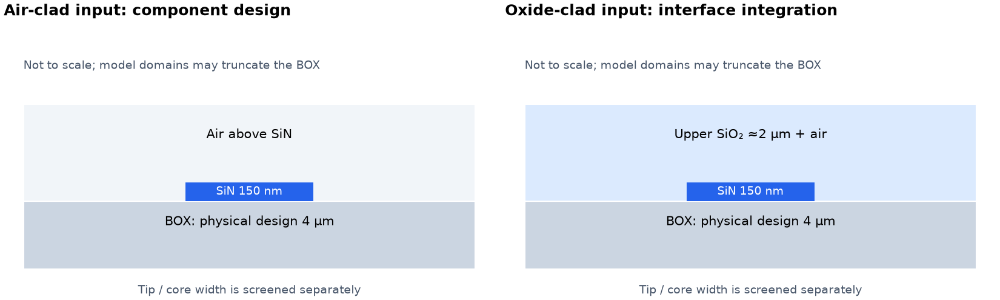
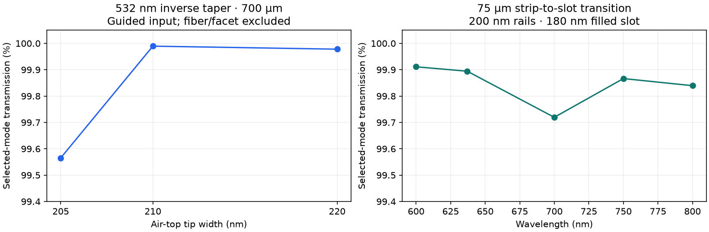
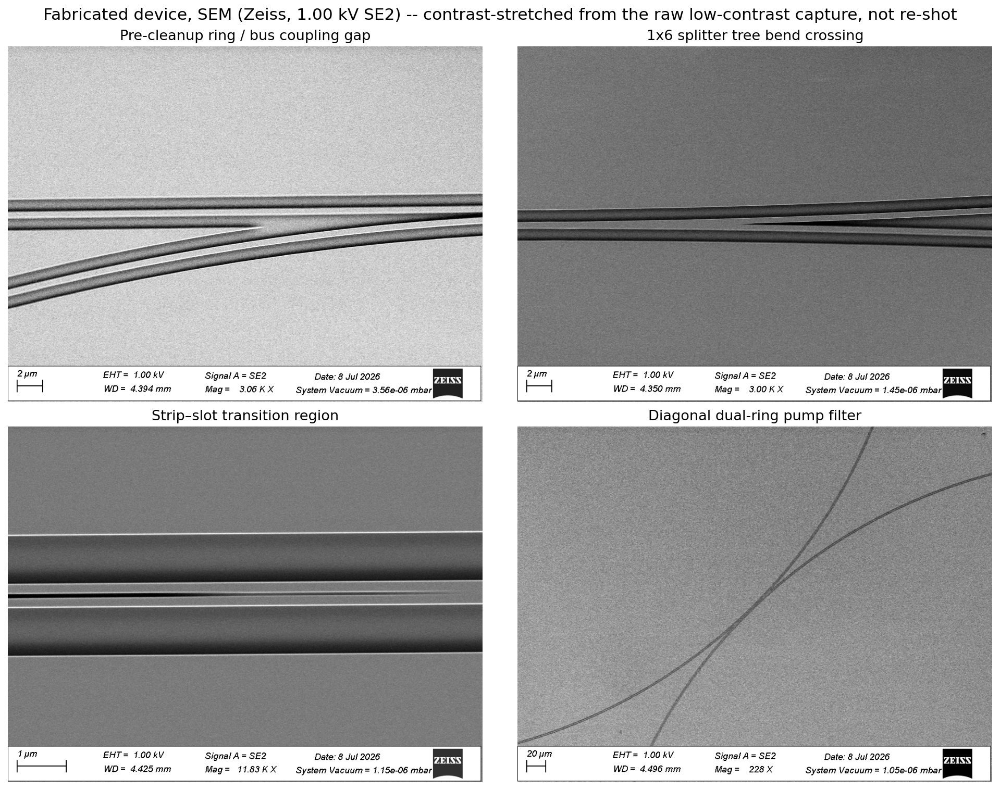
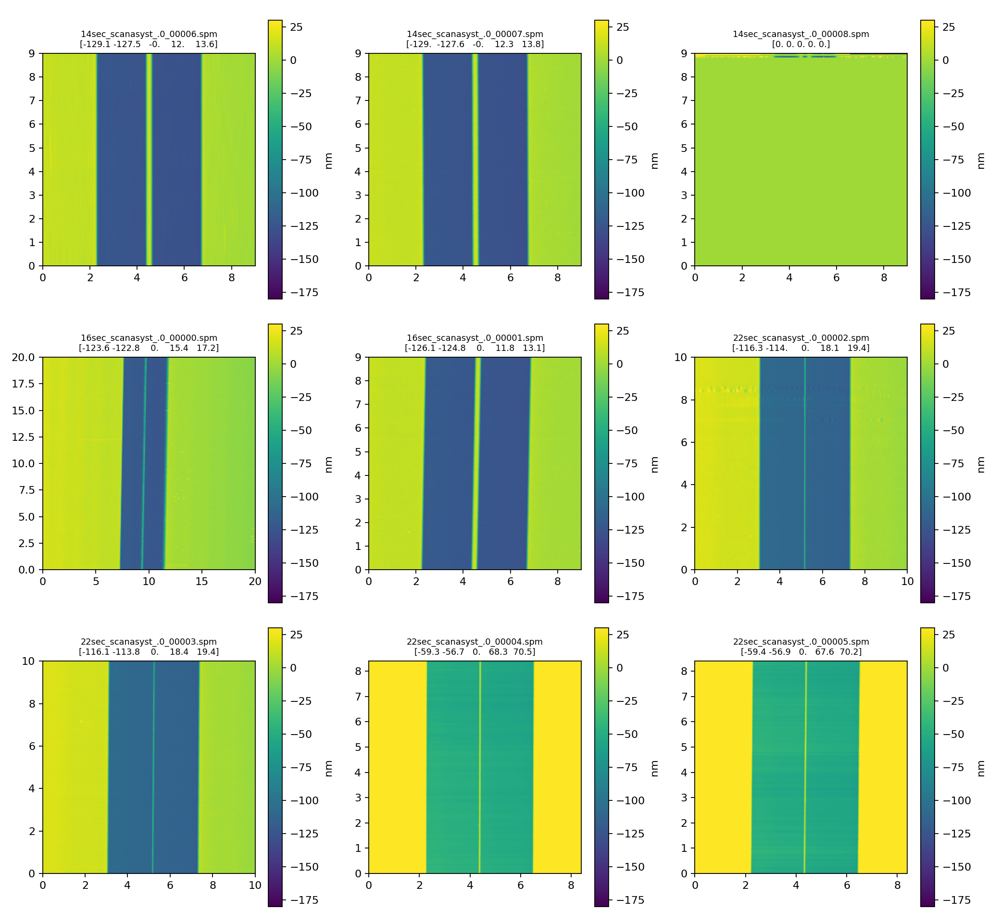
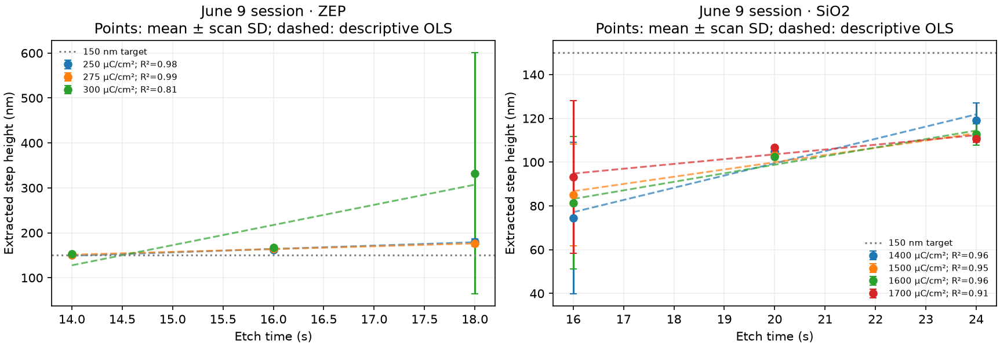
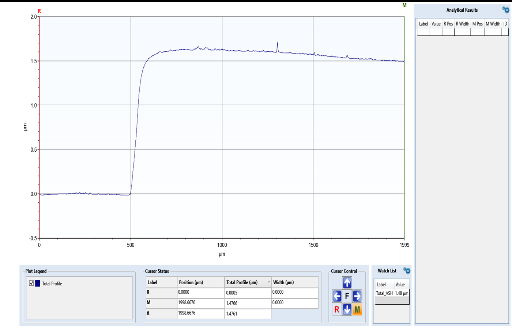
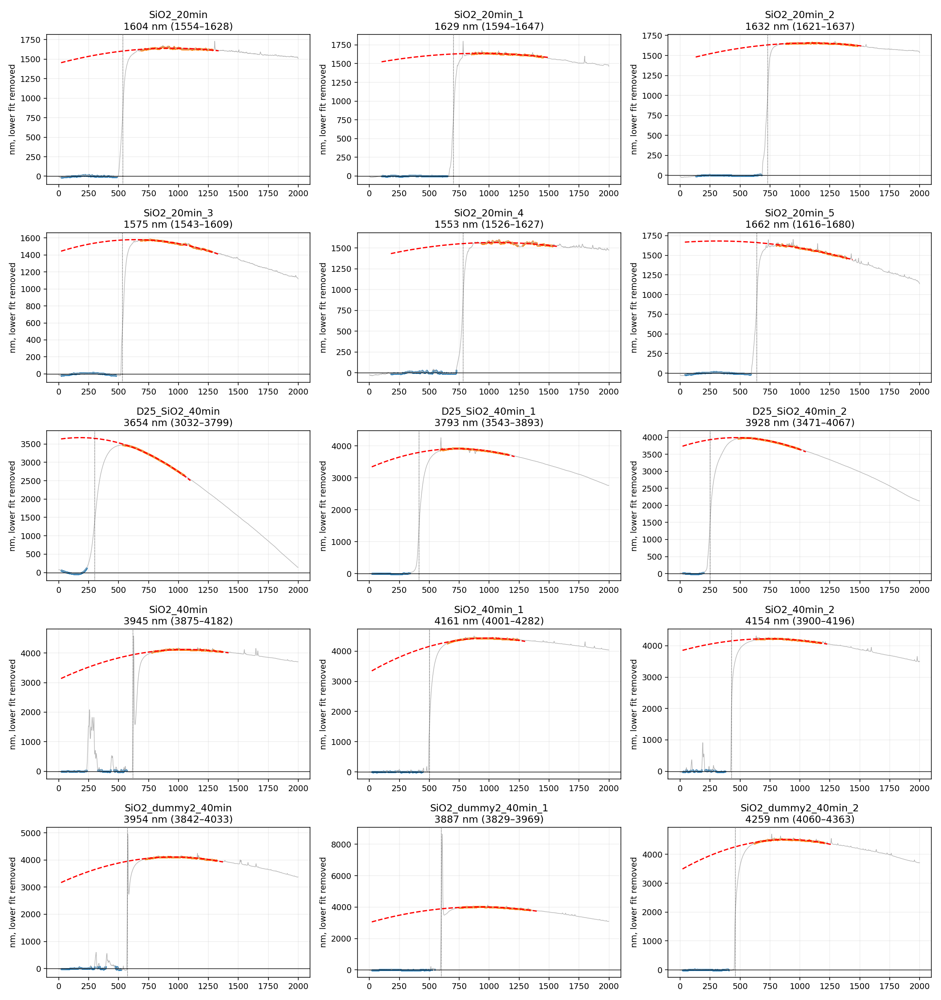

# SiN Photonic Components and Process Metrology

**Jun Young Hong · Optical interfaces, component modeling and fabrication checks**

The study connects visible-wavelength pump delivery and fluorescence collection with the geometry that fabrication can produce. It separates guided-mode transport, fiber/facet coupling and process metrology rather than treating one high simulated transmission as device validation.

## 1. Start with the physical stack

Changing cladding changes confinement and interface behavior. Air-clad and oxide-clad cases are distinct physical models, not one same-stack parameter sweep.

## 2. Separate propagation from coupling

The inverse-taper and strip-to-slot studies compare guided-mode transport under their stated model boundaries. The wavelength response is a component calculation, not measured fluorescence collection. Fiber-mode mismatch, alignment, facet quality and reflection remain additional interface effects.

## 3. Inspect fabricated structures

SEM images show coupling regions, routing and the strip-to-slot transition region of an earlier fabricated demonstrator. The original analysis adjusted image contrast. These are geometry observations, not measured optical performance or evidence that every modeled design was fabricated.

## 4. Read metrology before fitting a trend

The maps derive from measured SPM data. The unusable all-zero panel remains visible rather than being replaced by a simulated surface.

Within-session fixed-dose comparisons show scan variation and exploratory three-time-point fits. Scan SD and fitted trend are descriptive; they are not a qualified etch rate or manufacturing yield.

Baseline, edge selection and fitting window affect extracted thickness. The saved instrument reading and independent profile fit are different estimates. Historical fits are shown without claiming a new extraction or a common deposition calibration across batches.

## What the study changes

Metrology constrains the geometry that should enter optical models. Reference paths, facet inspection and alignment scans are needed to distinguish process variation from interface loss. Complete fiber-to-chip efficiency and integrated sensing operation are not established by these examples.

[Evidence and disclosure scope](CONTENT_NOTES.md) · [Experimental portfolio](https://github.com/juh112/photonics-testbenches-public)
