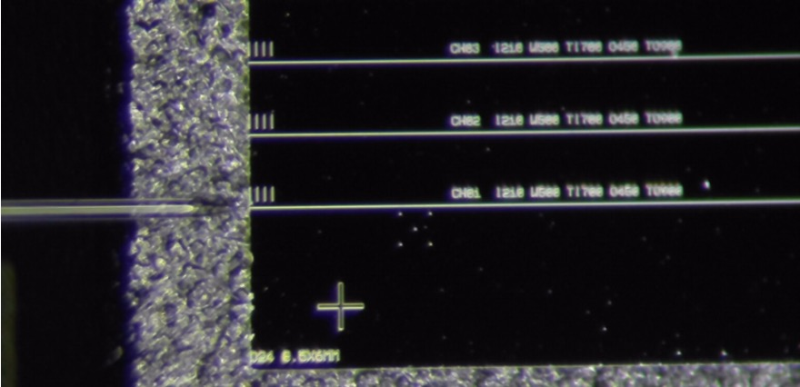
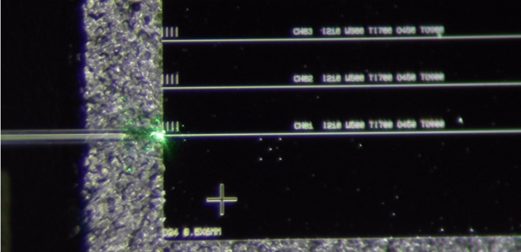
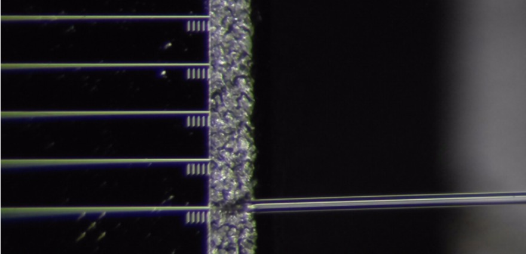
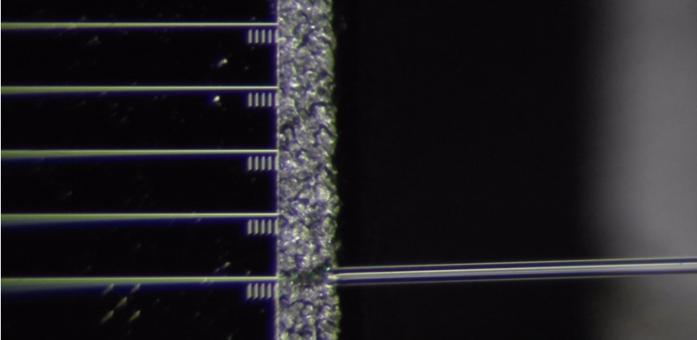
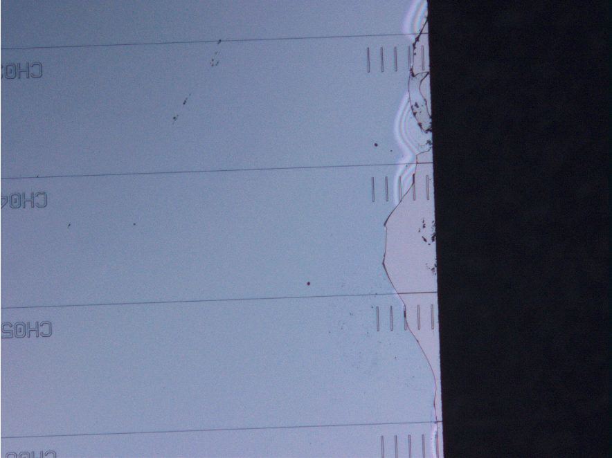
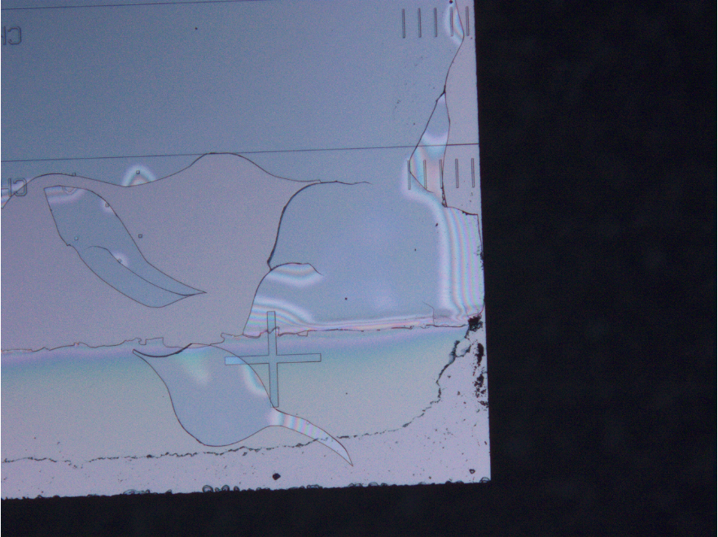

# 532 nm Fiber-to-Chip Edge-Coupling and Facet Preparation

## Objective

Investigate preliminary 532 nm fiber-to-chip alignment and identify practical limitations associated with optical facet preparation of SiN photonic test chips.

## Experimental Configuration

- **Wavelength:** 532 nm
- **Input:** Conical lensed single-mode fiber, approximately 3–4 µm beam diameter
- **Output collection configurations:** Conical lensed single-mode fiber (approximately 3–4 µm beam diameter) and multimode fiber (200 µm core, NA = 0.39)
- **Cladding:** Approximately 4 µm PECVD SiO2

## 1. Preliminary Edge-Coupling Observations

Microscope images were collected with the 532 nm laser OFF and ON at the input and output facets.

Localized green light was visible near the input fiber–chip interface when the laser was ON. This observation indicates light delivery to the facet region, but does not independently establish coupling into a guided waveguide mode.

No clear laser-dependent optical signal was identified at the output facet in the available microscope images.

**Current status:** End-to-end guided transmission and coupling efficiency have not yet been verified.

## 2. Facet Preparation and Damage Observations

Facet polishing trials were performed on photonic chips with approximately 4 µm PECVD SiO2 cladding.

Edge chipping was observed during polishing, and further fracture or damage was observed following ultrasonic cleaning.

The images document visible damage, but do not conclusively identify whether fracture originated in the oxide cladding, at an interface, or in the underlying substrate.

## 3. Next Experiments

1. Inspect polished facet geometry and damage using optical microscopy and, where available, SEM.
2. Repeat fiber alignment while measuring background-subtracted output optical power.
3. Compare output signals with laser OFF/ON controls and alignment-position sweeps.
4. Use reference waveguides to investigate insertion loss and distinguish possible coupling limitations from waveguide-related losses.
5. Assess whether polishing and cleaning procedures require modification.

## Measurement Status

This is a preliminary alignment and fabrication case study. No validated waveguide transmission, insertion loss, or coupling-efficiency value is claimed.

## Experimental Images

### Fiber-to-Chip Alignment — 532 nm

| Input: Laser OFF | Input: Laser ON |
|---|---|
|  |  |

| Output: Laser OFF | Output: Laser ON |
|---|---|
|  |  |

Localized green light was observed near the input facet with the laser ON. Guided transmission through the waveguide has not yet been confirmed.

### Facet Preparation and Damage

| Facet edge chipping | Damage after ultrasonic cleaning |
|---|---|
|  |  |

The images document polishing-related edge damage and subsequent fracture observations on chips with approximately 4 µm PECVD SiO2 cladding. The precise failure mechanism remains under investigation.

