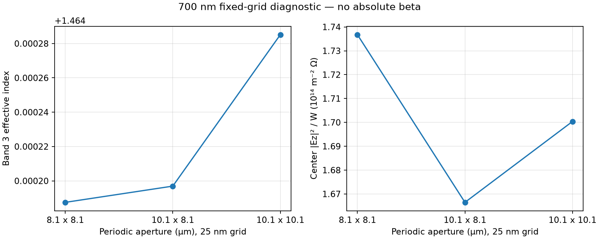

# NV fluorescence collection: numerical validation before design claims

This is a simulation diagnostic, not measured fluorescence collection or a released absolute beta factor.

At 700 nm, a weak selected mode in an assumed polymer-covered SiN slot remained sensitive to the numerical aperture. An existing 3D comparison changed lateral and vertical domains together, so it could not identify a unique direction of error.

New full-vector periodic mode calculations isolate lateral and vertical changes. Automatic FFT-grid optimization was found to change both grid spacing and parity when the cell changed. A corrected run disables that adjustment and interpolates the complex field at the same physical position. On a fixed 25 nm grid, the center longitudinal field intensity per unit modal power changes **4.05% laterally** and **2.03% vertically**. The lateral change exceeds the retained 3% diagnostic criterion. This is still a coarse-mesh, mode-only screen, not 3D nanodiamond domain convergence.

The assumed baseline uses a 150 nm SiN layer and a finite polymer cover with lossless constant material indices. Geometry parameters are model choices rather than verified fabricated dimensions. A finite oxide-open reservoir geometry is being modeled. No reservoir transmission or collection efficiency has been extracted yet.

**What this changes:** control actual grid spacing, mode identity and field sampling before selecting the next domain. Internal source-work and port consistency do not establish domain convergence. Absolute NV beta, complete guided-channel accounting and measured integrated-sensor performance remain unqualified.

This selected visual case study follows the repository's [evidence and disclosure scope](../../CONTENT_NOTES.md). Detailed code, raw field arrays, logs and unpublished design files are retained in the private research archive.
